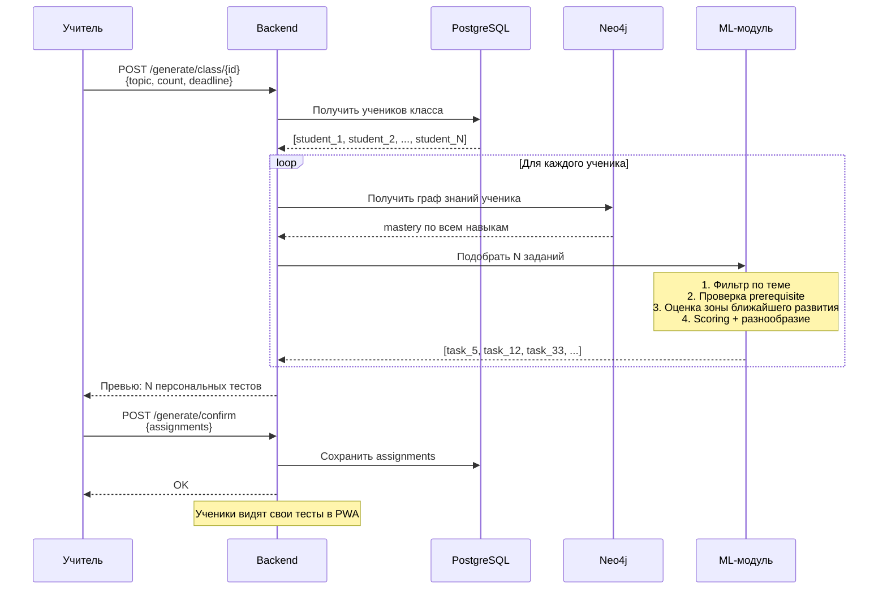
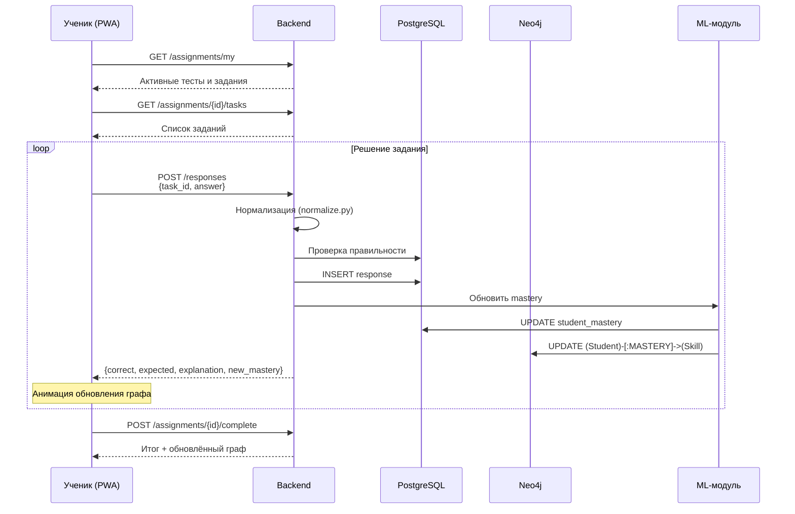
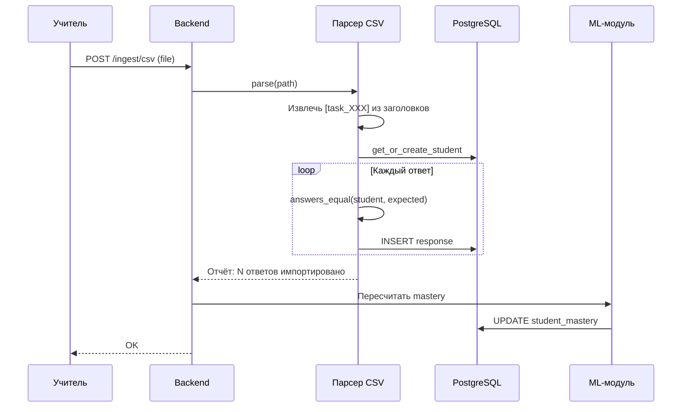
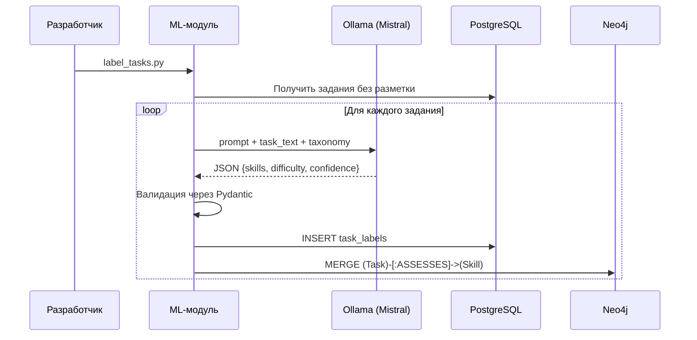

# HyperUm — Архитектура

**Версия:** 0.1
**Дата:** 2026-09

**Связанные документы:**
- `docs/requirements.md` — требования и scope
- `docs/data-model.md` — детальная схема данных (план)
- `README.md` — обзор и установка

---

## 1. Обзор архитектуры

HyperUm — full-stack система, включающая:

- **Backend API** — ядро логики, единая точка входа для всех клиентов.
- **Приложение ученика** (PWA) — решение заданий и просмотр графа.
- **Дашборд учителя/репетитора** — генерация тестов, аналитика.
- **ML-модуль** — оценка знаний, подбор заданий, прогнозы.
- **Две БД** — PostgreSQL (транзакционные данные) и Neo4j (граф знаний).
- **LLM-сервис** — локальная Mistral через Ollama (разметка заданий).

### 1.1. Принципы

1. **API-first.** Вся логика в backend, клиенты — тонкие.
2. **Multi-tenant с первого дня.** `tenant_id` везде, RLS в PostgreSQL.
3. **Три уровня данных.** Global (таксономия), shared (банк), isolated (PII и ответы).
4. **Core + adapters.** Ядро не зависит от организационной модели (школа / платформа).
5. **Идемпотентность.** Все скрипты можно запускать многократно.
6. **Единая точка правды.** Таксономия — в YAML; логика сравнения — в одном модуле.

---

## 2. Компоненты системы

```
┌─────────────────────────────────────────────────────────────────────┐
│                          КЛИЕНТЫ                                    │
│                                                                     │
│  ┌──────────────┐  ┌──────────────┐  ┌──────────┐  ┌────────────┐   │
│  │  PWA ученика │  │  Дашборд     │  │  CLI /   │  │  Платформа │   │
│  │  (React)     │  │  учителя     │  │  скрипты │  │  ПолиУм    │   │
│  │              │  │  (Streamlit) │  │          │  │  (внешний) │   │
│  └──────┬───────┘  └──────┬───────┘  └────┬─────┘  └─────┬──────┘   │
│         │                 │                │              │          │
│         └─────────────────┼────────────────┼──────────────┘          │
│                           │  HTTP / REST                            │
└───────────────────────────┼─────────────────────────────────────────┘
                            ▼
┌─────────────────────────────────────────────────────────────────────┐
│                       BACKEND (FastAPI)                             │
│                                                                     │
│  ┌──────────────┐  ┌───────────────┐  ┌───────────────┐             │
│  │ Auth / JWT   │  │ Tenant        │  │ Роутеры:      │             │
│  │              │  │ middleware    │  │ tasks,        │             │
│  │              │  │ (RLS)         │  │ assignments,  │             │
│  │              │  │               │  │ mastery,      │             │
│  │              │  │               │  │ graph,        │             │
│  │              │  │               │  │ generate      │             │
│  └──────────────┘  └───────────────┘  └───────┬───────┘             │
│                                                │                     │
│  ┌─────────────────────────────────────────────┼───────────────────┐ │
│  │                   SERVICES                  │                   │ │
│  │                                             ▼                   │ │
│  │  ┌────────────────┐  ┌──────────────┐  ┌─────────────────┐     │ │
│  │  │ TaskGenerator  │  │ Mastery      │  │ IngestService   │     │ │
│  │  │ (ядро!)        │  │ Service      │  │ (CSV + PWA)     │     │ │
│  │  └────────┬───────┘  └──────┬───────┘  └────────┬────────┘     │ │
│  │           │                 │                    │              │ │
│  │  ┌────────┴───────┐  ┌──────┴───────┐  ┌────────┴────────┐     │ │
│  │  │ ML: подбор     │  │ ML: knowledge│  │ Нормализация    │     │ │
│  │  │ (scoring,      │  │ tracing      │  │ ответов         │     │ │
│  │  │  bandit)       │  │ (BKT/DKT)    │  │ (normalize.py)  │     │ │
│  │  └────────────────┘  └──────────────┘  └─────────────────┘     │ │
│  └─────────────────────────────────────────────────────────────────┘ │
└──────┬───────────────────┬──────────────────────┬───────────────────┘
       │                   │                      │
       ▼                   ▼                      ▼
┌────────────┐      ┌────────────┐         ┌────────────┐
│ PostgreSQL │      │   Neo4j    │         │  Ollama    │
│            │      │            │         │  (Mistral) │
│ tasks      │      │ Module     │         │            │
│ users      │      │ Topic      │         │  label     │
│ responses  │      │ Skill      │         │  tasks     │
│ mastery    │      │ PREREQ     │         │            │
│ tenants    │      │ MASTERY    │         │            │
└────────────┘      └────────────┘         └────────────┘
```

---

## 3. Уровни данных

Три уровня, определяющих архитектуру:

| Уровень | Что входит | Где | Sharing |
|---------|-----------|-----|---------|
| **Global** | Таксономия: Module, Topic, Skill, Concept | PostgreSQL + Neo4j | Общий для всех tenant'ов |
| **Shared** | Банк заданий, разметка LLM, агрегированная статистика | PostgreSQL + Neo4j | Общий, но авторство сохраняется |
| **Isolated** | PII, ответы, mastery, группы, назначения | PostgreSQL (RLS) + Neo4j | Только внутри tenant'а |

**Правило:** всё, что описывает **контент** — shared. Всё, что привязано к **человеку** — isolated.

---

## 4. Ключевые потоки данных

### 4.1. Генерация персональных тестов (ядро системы)

Самый важный сценарий. Показывает, как ML-модуль подбирает **уникальный
набор заданий каждому ученику** за одно нажатие.



**Ключевые шаги ML-подбора:**

1. **Фильтр по теме.** Берём задания, связанные с навыками выбранной темы.
2. **Проверка prerequisite.** Убираем задания, у которых не выполнены предпосылки (например, вложенные циклы при неосвоенном `for`).
3. **Зона ближайшего развития.** Оцениваем сложность относительно mastery:
   - слишком легко (mastery > 0.85) — не берём;
   - слишком сложно (mastery < 0.2 по prerequisite) — не берём;
   - оптимально (0.3 ≤ mastery ≤ 0.7) — приоритет.
4. **Scoring.** Для каждого кандидата:
   ```
   score(task) = expected_learning_gain
               − risk_of_frustration
               + diversity_bonus
               − redundancy_penalty
   ```
5. **Отбор N заданий.** Жадный алгоритм с учётом разнообразия (не все задачи на один навык).

**Результат:** для класса из 25 учеников — 25 уникальных наборов.

### 4.2. Решение задания учеником



### 4.3. Импорт CSV из Яндекс.Форм (fallback)



### 4.4. Разметка заданий через LLM



---

## 5. Backend (FastAPI)

### 5.1. Структура

```
backend/
├── main.py                  # точка входа, middleware
├── config.py                # настройки из .env
├── auth/
│   ├── jwt.py               # генерация / проверка токенов
│   └── deps.py              # зависимости (get_current_user)
├── db/
│   ├── postgres.py          # engine, session, tenant_session
│   └── neo4j.py             # driver, query helpers
├── api/
│   ├── auth.py              # /auth/login, /auth/register
│   ├── tasks.py             # /tasks
│   ├── generate.py          # /generate/class, /generate/student
│   ├── assignments.py       # /assignments
│   ├── responses.py         # /responses
│   ├── mastery.py           # /mastery
│   ├── graph.py             # /graph/student
│   └── ingest.py            # /ingest/csv
├── services/
│   ├── task_generator.py    # ядро: подбор заданий
│   ├── mastery_service.py   # расчёт и обновление mastery
│   ├── ingest_service.py    # CSV, API-ответы
│   └── llm_labeler.py       # разметка через Ollama
├── ml/
│   ├── knowledge_tracing.py # BKT / DKT
│   ├── scoring.py           # функция полезности задания
│   └── bandit.py            # contextual bandit (позже)
└── models/
    ├── schemas.py           # Pydantic-схемы для API
    └── domain.py            # доменные модели
```

### 5.2. Middleware (tenant)

Каждый запрос проходит через middleware, который:

1. Извлекает JWT из заголовка.
2. Проверяет подпись и срок действия.
3. Достаёт `tenant_id` из claims.
4. Открывает сессию БД и выполняет `SET app.current_tenant = ...`.
5. Передаёт управление роутеру.

```python
@app.middleware("http")
async def tenant_middleware(request, call_next):
    token = extract_token(request)
    if token:
        payload = decode_jwt(token)
        tenant_id = payload["tenant_id"]
        request.state.tenant_id = tenant_id
        request.state.user_id = payload["sub"]
        request.state.role = payload["role"]
    return await call_next(request)
```

### 5.3. Роутеры (эндпоинты верхнего уровня)

| Метод | Путь | Назначение |
|-------|------|-----------|
| POST | `/auth/login` | Логин, возврат JWT |
| POST | `/auth/register` | Регистрация (учитель) |
| GET | `/tasks` | Список заданий (с фильтрами) |
| POST | `/tasks` | Создать задание |
| POST | `/tasks/{id}/label` | Разметить через LLM |
| POST | `/generate/class/{id}` | **Генерация теста для класса** |
| POST | `/generate/student/{id}` | Генерация для одного ученика |
| POST | `/generate/confirm` | Подтвердить и отправить |
| GET | `/assignments/my` | Задания текущего ученика |
| GET | `/assignments/{id}/tasks` | Задания конкретного теста |
| POST | `/responses` | Отправить ответ |
| GET | `/mastery/student/{id}` | Mastery ученика |
| GET | `/mastery/class/{id}` | Mastery класса |
| GET | `/graph/student/{id}` | Граф знаний ученика |
| POST | `/ingest/csv` | Загрузить CSV из Я.Форм |

---

## 6. Приложение ученика (PWA)

### 6.1. Стек

| Компонент | Технология |
|-----------|-----------|
| Фреймворк | React 18 + Vite |
| Роутинг | React Router |
| Состояние | Zustand или Redux Toolkit |
| HTTP | Axios / fetch |
| Стили | Tailwind CSS |
| Граф | Cytoscape.js |
| PWA | vite-plugin-pwa |

### 6.2. Структура

```
pwa/
├── public/
│   ├── manifest.json        # PWA-манифест
│   └── icons/               # иконки для домашнего экрана
├── src/
│   ├── main.tsx
│   ├── App.tsx
│   ├── api/                 # клиент REST API
│   ├── stores/              # состояние (auth, assignments)
│   ├── pages/
│   │   ├── Login.tsx
│   │   ├── Dashboard.tsx    # активные тесты + граф
│   │   ├── TaskSolve.tsx    # решение задания
│   │   ├── Graph.tsx        # граф знаний
│   │   └── History.tsx      # история
│   └── components/
│       ├── GraphView.tsx    # Cytoscape.js
│       ├── TaskCard.tsx
│       └── Feedback.tsx     # обратная связь после ответа
└── vite.config.ts
```

### 6.3. Экраны

| Экран | Что показывает |
|-------|---------------|
| **Login** | Логин / вход по коду класса |
| **Dashboard** | Активные тесты, граф, прогресс |
| **TaskSolve** | Текущее задание, ввод ответа, feedback |
| **Graph** | Полный граф знаний с раскраской |
| **History** | История ответов и прогресс |

### 6.4. Визуализация графа

- **Cytoscape.js** с layout `dagre` (иерархия) или `cose` (force-directed).
- **Цвета:** 🟢 mastery > 0.8 · 🟡 0.4–0.8 · 🔴 < 0.4 · ⚪ не изучено.
- **Клик на узел:** карточка навыка с описанием, mastery, попытками.
- **Анимация:** после ответа узел меняет цвет через CSS-transition.

---

## 7. Дашборд учителя

### 7.1. Первая версия — Streamlit

Быстро, без фронтенд-разработки. Запускается как отдельный процесс.

```
dashboard/
├── app.py                   # главный экран
├── pages/
│   ├── 1_Class_Overview.py  # тепловая карта класса
│   ├── 2_Generate_Test.py   # генерация теста
│   ├── 3_Student_Profile.py # профиль ученика
│   └── 4_Ingest_CSV.py      # загрузка ответов
├── components/
│   ├── heatmap.py           # plotly heatmap
│   ├── graph_view.py        # Neo4j + streamlit-agraph
│   └── task_preview.py      # превью сгенерированного теста
└── api_client.py            # клиент Backend API
```

**Почему Streamlit:**
- 2–3 дня vs 2–3 недели для React.
- Идеально для дашбордов.
- Хорошо смотрится на защите.

**Минусы:**
- Не продакшн-уровень.
- Ограниченная кастомизация.
- В v0.2 можно заменить на React.

### 7.2. Вторая версия — React

Если будет время, дашборд учителя переносится на React с тем же стеком,
что и PWA. Единый дизайн, единая авторизация, единый API-клиент.

---

## 8. ML-модуль

### 8.1. Задачи

| Задача | Метод | Где используется |
|--------|-------|------------------|
| Оценка mastery по навыку | BKT / DKT | После каждого ответа |
| Прогноз вероятности правильного ответа | IRT / логистическая регрессия | При подборе заданий |
| Scoring заданий для подбора | Функция полезности | Генерация теста |
| Прогноз проблемных зон | Кластеризация / DKT | Дашборд учителя |
| Персонализация | Contextual bandit | Рекомендации (позже) |

### 8.2. Baseline (для MVP)

1. **Mastery** = `correct / attempts` по навыку.
2. **Сложность задания** — из разметки (LLM или вручную).
3. **Scoring** — по правилам:
   - приоритет заданиям с mastery в [0.3, 0.7];
   - исключение заданий с невыполненными prerequisite;
   - ограничение на разнообразие (не больше 2 заданий на один навык).
4. **Рекомендация** — из топ-3 по score, случайный выбор.

### 8.3. Развитие

1. **Knowledge tracing** (BKT): учитываем забывание, перенос.
2. **DKT**: нейросетевая модель последовательности ответов.
3. **GNN на графе**: состояние ученика + структура prerequisite.
4. **Contextual bandit**: обучение на реальных данных пилота.

### 8.4. Где живёт ML

**Решение:** ML-модуль — **внутри backend** как Python-модуль, не отдельный сервис.

**Почему:**
- Один разработчик — проще.
- Нет сетевых задержек.
- Легко тестировать.
- Легко потом вынести в отдельный сервис, если понадобится.

---

## 9. Multi-tenancy

### 9.1. Уровни изоляции

| Уровень | Что | Где |
|---------|-----|-----|
| **Global** | Таксономия | `tenant_id = 'global'` |
| **Shared** | Банк заданий, разметка | `visibility = 'shared'` или `author_tenant` |
| **Isolated** | Пользователи, ответы, mastery | `tenant_id` обязателен + RLS |

### 9.2. Реализация в PostgreSQL

1. **Колонка `tenant_id`** во всех isolated-таблицах.
2. **RLS-политики**:
   ```sql
   CREATE POLICY tenant_isolation ON responses
     USING (tenant_id = current_setting('app.current_tenant', true));
   ```
3. **`FORCE ROW LEVEL SECURITY`** — чтобы политика действовала и для владельца.
4. **Backend** выставляет `SET app.current_tenant` при открытии сессии.

### 9.3. Реализация в Neo4j

1. **Свойство `tenant_id`** на узлах `Student` и на рёбрах `MASTERY`.
2. **Таксономия** имеет `tenant_id = 'global'`.
3. **Каждый запрос** фильтрует по tenant:
   ```cypher
   MATCH (st:Student {id: $sid, tenant_id: $tenant_id})
         -[m:MASTERY]->(s:Skill)
   RETURN s.id, m.value
   ```

### 9.4. Архитектурный принцип

Ядро **не знает**, что такое «школа» или «платформа». Оно знает только
`tenant_id` и роли (`owner`, `student`, `admin`). Различия между школой
и платформой — в конфигурации tenant'а, а не в коде.

---

## 10. Безопасность

### 10.1. Аутентификация

- **JWT** с коротким сроком жизни (15 мин) + **refresh token** (30 дней).
- В claims: `sub` (user_id), `tenant_id`, `role`.
- Пароли — **bcrypt** (или argon2).

### 10.2. Авторизация

- **RBAC**: owner / student / admin.
- Проверка прав на уровне роутера через зависимости FastAPI.
- RLS в БД как второй рубеж.

### 10.3. PII

- PII (ФИО, email) — только в таблице `users` (isolated).
- В Neo4j — только UUID, без PII.
- **Анонимизация** для ML: работаем с `student_id`, не с ФИО.

### 10.4. 152-ФЗ

- Согласие родителей (школа) / оферта (платформа).
- Хранение данных на территории РФ.
- Возможность удаления учётной записи.
- Логирование доступа к PII.

---

## 11. Развёртывание

### 11.1. Docker Compose (dev и prod)

```yaml
services:
  postgres:
    image: postgres:16
    # ...
  neo4j:
    image: neo4j:5
    # ...
  backend:
    build: ./backend
    ports: ["8000:8000"]
    depends_on: [postgres, neo4j]
  pwa:
    build: ./pwa
    ports: ["3000:80"]
  dashboard:
    build: ./dashboard
    ports: ["8501:8501"]
```

**Ollama** — вне Docker, чтобы работать с GPU напрямую.

### 11.2. Окружения

| Окружение | Где | Назначение |
|-----------|-----|-----------|
| **dev** | Локально, Windows | Разработка |
| **pilot** | Сервер университета | Пилот в лицее |
| **prod** | Облако РФ (позже) | Платформа |

### 11.3. CI/CD

- **GitHub Actions** — линтер, тесты, сборка Docker-образов.
- **Деплой** — вручную на первом этапе, автоматизация позже.

---

## 12. Стек (сводка)

| Слой | Технология | Обоснование |
|------|-----------|-------------|
| Backend | FastAPI + Python 3.11 | Быстрый, async, OpenAPI из коробки |
| БД (транзакции) | PostgreSQL 16 | Надёжно, RLS, JSONB |
| БД (граф) | Neo4j 5 | Естественно для графов, визуализация |
| ML | scikit-learn, PyTorch | Стандарт |
| LLM | Ollama + Mistral 7B | Локально, без облака |
| PWA | React + Vite + Tailwind | Один код для всех экранов |
| Граф UI | Cytoscape.js | Мощный, гибкий |
| Дашборд | Streamlit | Быстро для MVP |
| Инфра | Docker Compose | Просто, кросс-платформенно |
| Auth | JWT + bcrypt | Стандарт |

---

## 13. Что дальше

Документы, которые дополняют архитектуру:

1. **`docs/data-model.md`** — детальная схема всех таблиц и узлов графа.
2. **`docs/api.md`** — OpenAPI-спецификация эндпоинтов.
3. **`docs/ml.md`** — детали ML-модуля: модели, фичи, метрики.
4. **`docs/deployment.md`** — как разворачивать на сервере.

---

## 14. Изменения

| Версия | Дата | Что изменилось |
|--------|------|----------------|
| 0.1 | 2026-09 | Первая версия |