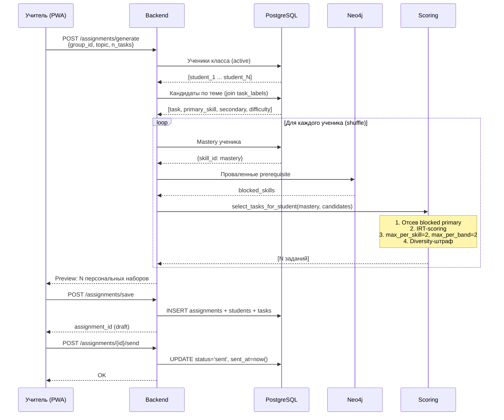
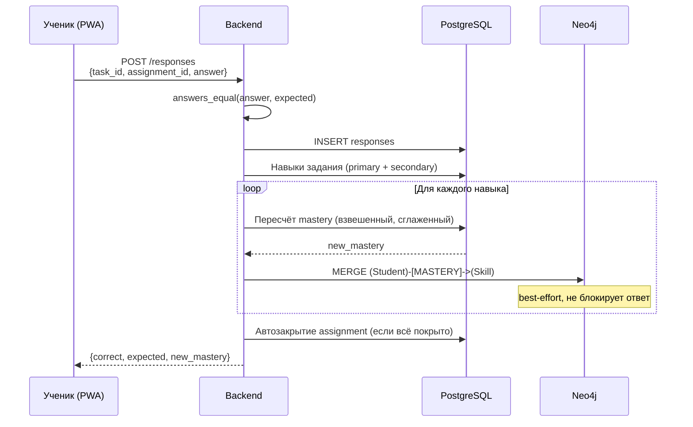
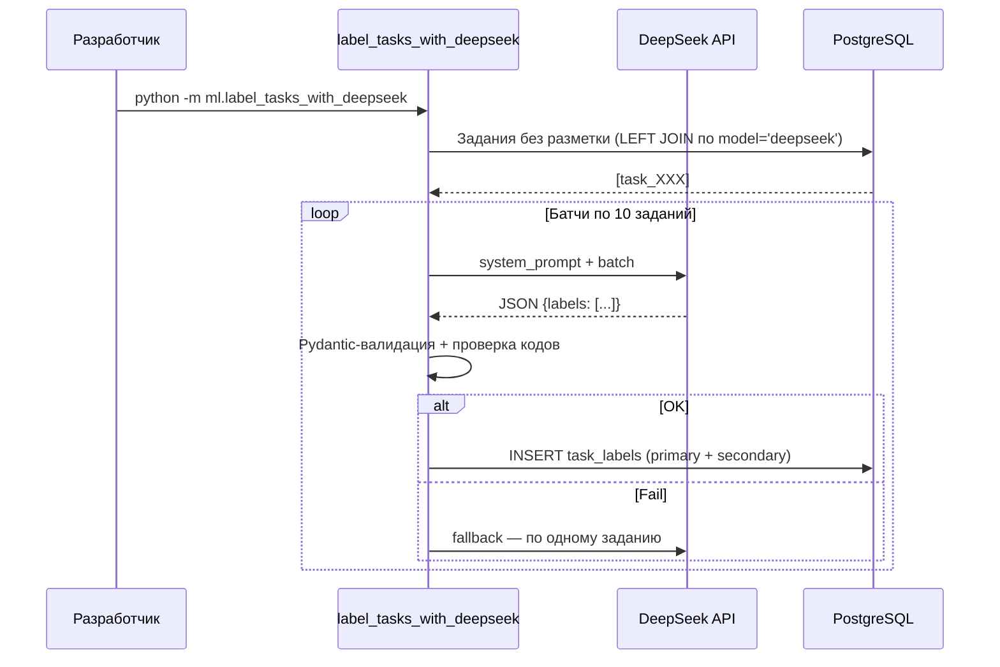
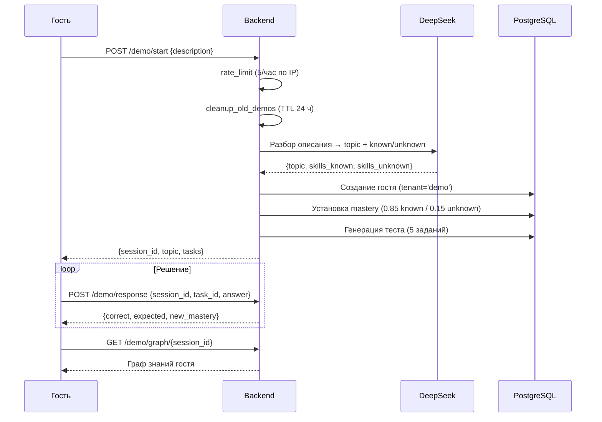
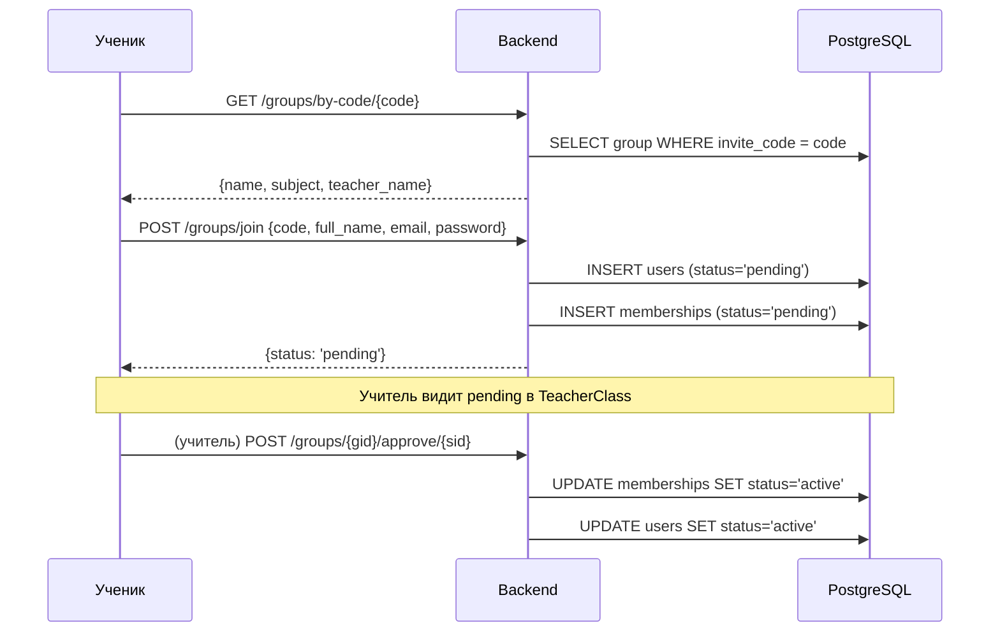

# HyperUm — Архитектура

**Версия:** 1.0
**Дата:** 2026-10
**Статус:** актуальная. Отражает состояние на момент пилота в лицее при ТПУ.

**Связанные документы:**
- `glossary.md` — словарь терминов
- `data-model.md` — схема данных
- `requirements.md` — требования и статусы
- `ml.md` — ML-модуль
- `api.md` — обзор API
- `user-flows.md` — сценарии
- `deployment.md` — развёртывание
- `decisions.md` — архитектурные решения

---

## 1. Что такое HyperUm

Система гиперперсонализации образовательного процесса на основе графа знаний
и ML-моделей. Работает как **интеллектуальный ассистент учителя**:
наставник задаёт тему, система подбирает **персональный набор заданий
каждому ученику** с опорой на его граф знаний.

Ключевое отличие от адаптивных систем (Учи.ру, ЯКласс): HyperUm
**не заменяет** учителя и **не раздаёт** всем одинаковые задания.
Одно нажатие кнопки → N персональных тестов для N учеников.

**Развёрнут и работает:** https://hyperum.polyum.ru  
**Апробация:** Лицей при ТПУ, 3 класса, 67 учеников.

### Научная цель

HyperUm — не только продукт, но и **фабрика данных** для обучения модели,
которая заменит эвристический подбор заданий на обученный на реальных
исходах пилота.

**Текущее состояние** (baseline): mastery считается формулой (взвешенный
`correct / attempts` + сглаживание), задания подбираются IRT-подобной
функцией полезности, prerequisite-фильтр — порог mastery < 0.5.

**Что делаем дальше:** обучение BKT → graph-BKT → A/B тест.

Полная научная рамка, гипотезы H1–H5, метрики и план эксперимента — в
[`research.md`](research.md).

---

## 2. Компоненты системы

```
┌──────────────────────────────────────────────────────────────────────┐
│                            КЛИЕНТЫ                                   │
│                                                                      │
│  ┌────────────────────┐  ┌────────────────────┐  ┌──────────────┐   │
│  │ PWA ученика        │  │ PWA учителя        │  │ ПолиУм       │   │
│  │ (React + Vite)     │  │ (в том же билде)   │  │ (внешний,    │   │
│  │                    │  │                    │  │  в планах)   │   │
│  └──────────┬─────────┘  └──────────┬─────────┘  └──────┬───────┘   │
│             │                       │                    │           │
│             └───────────────────────┼────────────────────┘           │
│                                     │ REST + JWT (cookies/Bearer)    │
└─────────────────────────────────────┼────────────────────────────────┘
                                      ▼
┌──────────────────────────────────────────────────────────────────────┐
│                      NGINX (VPS hyperum.polyum.ru)                   │
│                      статика + reverse proxy                         │
└─────────────────────────────────────┬────────────────────────────────┘
                                      ▼
┌──────────────────────────────────────────────────────────────────────┐
│                       BACKEND (FastAPI)                              │
│                                                                      │
│  ┌───────────────┐  ┌──────────────────┐  ┌────────────────────┐    │
│  │ auth          │  │ RLS / tenant     │  │ Роутеры:           │    │
│  │ JWT+bcrypt    │  │ middleware       │  │ tasks, mastery,    │    │
│  │               │  │                  │  │ graph, assignments,│    │
│  │               │  │                  │  │ responses, groups, │    │
│  │               │  │                  │  │ demo, auth         │    │
│  └───────────────┘  └──────────────────┘  └────────┬───────────┘    │
│                                                     │                │
│  ┌──────────────────────────────────────────────────┼──────────┐     │
│  │                    SERVICES                      │          │     │
│  │                                                  ▼          │     │
│  │  ┌───────────────────┐  ┌─────────────────┐  ┌───────────┐ │     │
│  │  │ assignments       │  │ responses       │  │ mastery   │ │     │
│  │  │ _service          │  │ _service        │  │ _service  │ │     │
│  │  │                   │  │                 │  │           │ │     │
│  │  │ IRT-scoring,      │  │ check + save +  │  │ агрегация │ │     │
│  │  │ prerequisite,     │  │ mastery update +│  │ по ученику│ │     │
│  │  │ diversity         │  │ Neo4j sync      │  │ и классу  │ │     │
│  │  └─────────┬─────────┘  └────────┬────────┘  └───────────┘ │     │
│  │            │                     │                          │     │
│  │  ┌─────────┴─────────┐  ┌────────┴────────┐  ┌───────────┐ │     │
│  │  │ graph_service     │  │ groups_service  │  │ tasks     │ │     │
│  │  │ Neo4j + PG        │  │ регистрация,    │  │ _service  │ │     │
│  │  │                   │  │ инвайты, approve│  │           │ │     │
│  │  └───────────────────┘  └─────────────────┘  └───────────┘ │     │
│  │                                                             │     │
│  │  ┌───────────────────┐                                      │     │
│  │  │ demo_service      │                                      │     │
│  │  │ LLM-разбор +      │                                      │     │
│  │  │ rate limit + TTL  │                                      │     │
│  │  └───────────────────┘                                      │     │
│  └─────────────────────────────────────────────────────────────┘     │
└──────┬────────────────────────┬──────────────────────────┬───────────┘
       │                        │                          │
       ▼                        ▼                          ▼
┌─────────────┐         ┌─────────────┐            ┌─────────────┐
│ PostgreSQL  │         │   Neo4j     │            │  DeepSeek   │
│ 16          │         │   5         │            │  API        │
│             │         │             │            │             │
│ tenants     │         │ :Module     │            │ разметка    │
│ users       │         │ :Topic      │            │ demo-парсинг│
│ groups      │         │ :Skill      │            │             │
│ memberships │         │ PREREQUISITE│            │             │
│ tasks       │         │ :Student    │            │             │
│ task_labels │         │ MASTERY     │            │             │
│ responses   │         │             │            │             │
│ mastery     │         │             │            │             │
│ assignments │         │             │            │             │
└─────────────┘         └─────────────┘            └─────────────┘
```

### 2.1. Три уровня данных

| Уровень | Что входит | Где | Sharing |
|---------|-----------|-----|---------|
| **Global** | Таксономия: Module → Topic → Skill | Neo4j + PG (`skills`) | Общий для всех tenant'ов |
| **Shared** | Банк заданий, разметки, агрегированная статистика | PG (`tasks`, `task_labels`, `task_stats`) | Общий, авторство сохраняется |
| **Isolated** | PII, ответы, mastery, группы, назначения | PG (RLS) + Neo4j (`:Student`, `MASTERY`) | Только внутри tenant'а |

**Правило:** всё, что описывает **контент**, — shared. Всё, что привязано к **человеку**, — isolated.

### 2.2. Контексты применения

| Контекст | Площадка | Модель |
|----------|----------|--------|
| Школьный | Лицей при ТПУ | Учитель + класс (`group.kind = 'class'`) |
| Платформенный | ПолиУм | Репетитор + 1–10 учеников (`tutor_group`, `one_on_one`) |
| Демо | Лендинг | Анонимный гость, TTL 24 ч |

Ядро системы не зависит от контекста. Различается только организационная модель.

---

## 3. Ключевые потоки данных

### 3.1. Генерация персональных тестов (ядро системы)



**Ключевые шаги подбора (assignments_service.py):**

1. **Фильтр по теме.** Задания, размеченные хотя бы на один навык темы.
2. **Отсев по prerequisite.** Если у ученика mastery prerequisite < 0.5 — задание блокируется.
3. **Взвешенная mastery.** `effective = 0.7 × mastery(primary) + 0.3 × avg(mastery(secondary))`.
4. **IRT-подобный score:**
   ```
   p_correct = sigmoid(4 × (mastery − difficulty))
   base = exp(−(p_correct − 0.7)² / 0.08)     ← пик при p ≈ 0.7
   if mastery < 0.5: base *= 1.4               ← бонус слабым
   score = base / (1 + 0.5 × usage_count)      ← diversity
   ```
5. **Отбор с ограничениями:** ≤2 заданий на primary-навык, ≤2 в одну difficulty-полосу.
6. **Добор** (если выбрано меньше N): два прохода — без band-ограничения, затем без всего.

**Результат:** для класса из 25 учеников — 25 уникальных наборов. Слабые получают задания сложности 0.4–0.5, сильные — 0.75–0.85.

### 3.2. Ответ ученика и обновление mastery



**Формула mastery (responses_service.py):**

- **Взвешенные attempts/correct:**
  ```
  w_attempts = Σ (1.0 если primary, 0.7 если secondary)
  w_correct  = Σ (вес × correct)
  ```
- **Байесовское сглаживание:**
  ```
  mastery = (w_correct + 0.5 × 3) / (w_attempts + 3)
  ```
  При малом числе попыток значение тянется к 0.5. При большом — доверяем данным.

- **В `student_mastery`** пишутся **сырые** `attempts` и `correct` (для отображения), а mastery — по взвешенным.

**Синхронизация в Neo4j** — best-effort. Если Neo4j недоступен, ответ ученику всё равно возвращается.

### 3.3. Разметка заданий через DeepSeek



**Параметры:**
- Батч: 10 заданий, `temperature=0.2`, JSON mode.
- Retry: 2 попытки на батч, затем fallback по одному.
- Каждый батч — отдельная транзакция (не терять прогресс).

### 3.4. Demo-режим (лендинг)



**Особенности:**
- Отдельный tenant `demo`, отдельная группа `dddddddd-…`.
- Rate limit — in-memory `dict[ip, list[datetime]]`. **Точка роста:** Redis.
- Cleanup — при каждом новом старте удаляются гости старше 24 ч.
- Гость решает через тот же `responses_service.submit_response`.

### 3.5. Регистрация ученика по коду класса



---

## 4. Backend (FastAPI)

### 4.1. Структура

```
backend/
├── main.py                  # FastAPI app, lifespan, CORS, роутеры
├── config.py                # Settings из .env (класс, не pydantic-settings)
│
├── auth/
│   ├── security.py          # bcrypt, JWT (create/decode)
│   └── dependencies.py      # get_current_user, require_teacher, require_student
│
├── db/
│   ├── postgres.py          # engine, SessionLocal, get_session, tenant_session
│   └── neo4j.py             # driver, neo4j_session, ping, shutdown
│
├── api/                     # HTTP-роутеры (тонкие)
│   ├── auth.py              # /auth/login, /logout, /me
│   ├── tasks.py             # /tasks, /tasks/{id}, /tasks/topics
│   ├── mastery.py           # /mastery/me, /student/{id}, /class/{id}
│   ├── graph.py             # /graph/full, /student/{id}, /class/{id}
│   ├── assignments.py       # /assignments/generate, save, send, my
│   ├── responses.py         # /responses, /my, /task/{id}
│   ├── groups.py            # /groups (CRUD + join + approve)
│   └── demo.py              # /demo/start, /response, /graph
│
├── services/                # бизнес-логика (толстая)
│   ├── tasks_service.py
│   ├── mastery_service.py
│   ├── graph_service.py     # Neo4j + PostgreSQL
│   ├── assignments_service.py  # ядро: генератор тестов
│   ├── responses_service.py    # ядро: проверка + mastery + Neo4j
│   ├── groups_service.py
│   └── demo_service.py
│
├── models/                  # Pydantic-схемы
│   ├── common.py            # PaginatedResponse, Pagination
│   ├── auth.py              # LoginRequest, TokenResponse
│   ├── users.py             # UserResponse, MeResponse
│   ├── tasks.py             # TaskResponse, TaskBrief, TaskLabel
│   ├── assignments.py       # GenerateRequest, GeneratedTest, ...
│   ├── responses.py         # ResponseCreate, StudentMastery, ...
│   ├── graph.py             # GraphNode, GraphEdge, StudentGraph
│   ├── groups.py            # GroupCreate, GroupDetail, ...
│   └── demo.py              # DemoStartRequest, DemoTask, ...
│
└── Dockerfile
```

**Принцип:** роутер тонкий (валидация Pydantic + вызов сервиса), сервис — вся логика. SQL пишется прямо в сервисах через SQLAlchemy `text()`.

### 4.2. Multi-tenancy через RLS

Все isolated-таблицы защищены Row-Level Security. Backend в начале каждой сессии выполняет:

```sql
SET LOCAL app.current_tenant = '<tenant_id>';
```

`SET LOCAL` работает в пределах транзакции. При возврате соединения в пул переменная сбрасывается — это **критично**, без `LOCAL` значение могло бы «протечь» в следующий запрос.

Реализовано в `backend/db/postgres.py`:

```python
@contextmanager
def tenant_session(tenant_id: str):
    session = SessionLocal()
    try:
        session.begin()
        session.execute(
            text("SELECT set_config('app.current_tenant', :t, true)"),
            {"t": tenant_id},
        )
        yield session
        session.commit()
    except Exception:
        session.rollback()
        raise
    finally:
        session.close()
```

### 4.3. Аутентификация

- **JWT** в httpOnly cookies (`hyperum_access` 1 ч, `hyperum_refresh` 30 дней) **+** Bearer-токен в JSON (для интеграций).
- **Пароли** — bcrypt.
- **Роли:** `owner`, `student`, `admin`.
- **Зависимости:** `get_current_user`, `require_teacher`, `require_student`.

**Cookies:**
```python
COOKIE_COMMON = {
    "httponly": True,       # JS не читает
    "secure": False,        # True в проде (сейчас HTTP-дев)
    "samesite": "lax",      # защита от CSRF
}
```

**Важно:** `secure=False` сейчас, при деплое на HTTPS — обязательно `True`.

---

## 5. PWA (ученик + учитель)

Один Vite-билд, роутинг по ролям.

### 5.1. Стек

| Слой | Технология |
|------|-----------|
| Фреймворк | React 18 |
| Сборка | Vite |
| Стили | Tailwind CSS |
| Состояние | Zustand (`authStore`) |
| Data fetching | TanStack Query |
| HTTP | Axios |
| Граф | Cytoscape.js + cytoscape-dagre |
| PWA | vite-plugin-pwa (workbox, autoUpdate) |
| Роутинг | React Router |

### 5.2. Структура

```
pwa/src/
├── App.tsx                  # роутинг по ролям
├── main.tsx
├── index.css                # tailwind + кастомные утилиты
│
├── api/                     # axios-клиент + типы
│   ├── client.ts            # baseURL='/api/v1', withCredentials
│   ├── auth.ts
│   ├── assignments.ts
│   ├── responses.ts
│   ├── mastery.ts
│   ├── graph.ts
│   ├── groups.ts
│   └── demo.ts
│
├── stores/
│   └── authStore.ts         # Zustand
│
├── hooks/
│   └── useSwipeBack.ts      # edge-swipe навигация
│
├── components/
│   ├── GraphView.tsx        # Cytoscape
│   ├── SkillCard.tsx        # модалка навыка
│   ├── AssignmentCard.tsx
│   ├── MasteryList.tsx
│   ├── Header.tsx
│   ├── ProtectedRoute.tsx
│   └── teacher/
│       ├── GroupCard.tsx
│       ├── StudentRow.tsx
│       ├── PendingStudentCard.tsx
│       └── InviteCodeBlock.tsx
│
└── pages/
    ├── Landing.tsx          # публичный + demo-виджет
    ├── Login.tsx
    ├── Join.tsx             # регистрация по коду
    ├── Dashboard.tsx        # ученик
    ├── Assignment.tsx       # решение теста
    ├── Graph.tsx            # граф знаний
    ├── History.tsx          # история ответов
    ├── DemoTest.tsx         # demo-сценарий
    └── teacher/
        ├── TeacherDashboard.tsx
        ├── TeacherClass.tsx
        └── TeacherGenerate.tsx
```

### 5.3. Ключевые UX-решения

- **Мобильный-first:** safe-area, фиксированная нижняя панель, edge swipe.
- **Индикатор прогресса** — точки-полоски в шапке (пройденные/текущий/непройденные).
- **Сдача задания** — модальное подтверждение, `surrendered=true`.
- **Восстановление прогресса** — `previous_response` в `assignment_tasks` (per-student).
- **Авто-редирект по ролям** — `ProtectedRoute` + `homeRedirect`.
- **PWA-манифест:** standalone, portrait, иконки 192/512.

### 5.4. Визуализация графа (Cytoscape.js)

- Layout: `dagre` (иерархия).
- Цвета: 🟢 mastered (≥0.8) · 🟡 learning (0.5–0.8) · 🔴 weak (<0.5) · ⚪ unknown.
- Клик на узел → `SkillCard` с описанием.
- Тумблер «показать неизученные».

---

## 6. PostgreSQL

**Версия:** 16  
**Роль:** транзакционные данные + RLS.

### 6.1. Ключевые таблицы

Полная схема — в `data-model.md`. Кратко:

| Группа | Таблицы |
|--------|---------|
| Tenancy | `tenants` |
| Таксономия | `skills` |
| Банк заданий | `tasks`, `task_labels`, `task_stats` |
| Пользователи | `users`, `groups`, `memberships` |
| Учебный процесс | `assignments`, `assignment_students`, `assignment_tasks` |
| Ответы и оценки | `responses`, `student_mastery` |

### 6.2. Индексы

- `responses(tenant_id, student_id)` — для истории ученика.
- `responses(task_id)` — для статистики.
- `task_labels(task_id, model)` — для primary-навыков.
- `groups(tenant_id, name)` unique где `kind='class'` — уникальность имени класса.
- `groups(invite_code)` unique — быстрый поиск по коду.
- `users(email)` — для логина.

### 6.3. Миграции

18 нумерованных файлов в `migrations/`. Запускаются скриптом `scripts/migrate.ps1`.

Порядок важен, применяется идемпотентно.

---

## 7. Neo4j

**Версия:** 5  
**Роль:** структура графа знаний + связи prerequisite.

### 7.1. Модель

```cypher
(:Module {name})-[:CONTAINS]->(:Topic {name})-[:CONTAINS]->(:Skill {id, name, difficulty})
(:Skill)-[:PREREQUISITE]->(:Skill)
(:Student {id, tenant_id})-[:MASTERY {value, attempts, correct, updated_at}]->(:Skill)
```

### 7.2. Что хранит и что нет

| Данные | Где живёт |
|--------|-----------|
| Структура графа (модули, темы, навыки, prerequisite) | **Neo4j** |
| Mastery ученика (источник истины) | **PostgreSQL** (`student_mastery`) |
| Mastery ученика (копия для визуализации) | Neo4j, ребро `MASTERY` |

**Итого:** Neo4j — источник **структуры**, PostgreSQL — источник **оценок**. При чтении графа (`graph_service.get_student_graph`) структура берётся из Neo4j, mastery навешивается из PostgreSQL.

### 7.3. Проверка prerequisite

При генерации теста `assignments_service.get_weak_prerequisites` запрашивает Neo4j:

```cypher
MATCH (st:Student {id: $stid})-[m:MASTERY]->(pre:Skill)
WHERE m.value < 0.5
MATCH (pre)-[:PREREQUISITE]->(target:Skill)
WHERE target.id IN $sids
RETURN DISTINCT target.id AS blocked
```

При недоступности Neo4j — возвращает пустое множество (все задания доступны).

### 7.4. Best-effort sync

`responses_service.sync_mastery_to_neo4j` обёрнут в `try/except`. Ошибка не ломает ответ ученику.

---

## 8. Разметка заданий

### 8.1. Pipeline

```
CSV с заданиями
    │
    ▼
scripts/import_tasks.py  →  INSERT INTO tasks (code, text, answer, type)
    │
    ▼
ml/label_tasks_with_deepseek.py  →  INSERT INTO task_labels
    │
    ▼
ml/normalize_difficulty.py  →  UPDATE task_labels.difficulty
```

### 8.2. Multi-skill

Одна разметка = один навык. Одно задание → 1 primary + 0–2 secondary.

**В `task_labels`:**
- PK: `(task_id, skill_id, model)`
- `is_primary BOOLEAN` — флаг главного.

### 8.3. Модели LLM

| Модель | Файл | Статус |
|--------|------|--------|
| DeepSeek (`deepseek-chat`) | `label_tasks_with_deepseek.py` | **актуально** |
| GigaChat | `label_tasks_with_gigachat.py` | устарело, оставлено как референс |

**Общие параметры DeepSeek:**
- Batch size: 10 заданий.
- Retry: 2 попытки на батч, затем fallback по одному.
- `temperature=0.2`, `response_format=json_object`.

### 8.4. Нормализация сложностей

LLM склонны кластеризовать difficulty в узком диапазоне (0.4–0.6).  
`ml/normalize_difficulty.py` растягивает распределение к равномерному.

---

## 9. Оценка mastery (baseline)

**Важно:** описанное ниже — это **baseline**, работающий сейчас. В рамках
научной части ВКР он будет заменён на BKT → graph-BKT (см. `research.md`,
раздел 6). Пока это источник истины для прода и точка отсчёта для
сравнения.

### 9.1. Формула

```python
PRIOR = 0.5      # сглаживание к среднему
WEIGHT = 3.0     # виртуальных попыток

def smoothed_mastery(w_correct, w_attempts):
    return (w_correct + PRIOR * WEIGHT) / (w_attempts + WEIGHT)
```

### 9.2. Веса

| Тип навыка | Вес |
|-----------|-----|
| primary | 1.0 |
| secondary | 0.7 |

**Почему:** primary-навык задание проверяет по существу, secondary — задействован попутно. Полный вес secondary исказил бы картину.

### 9.3. Обновление

При каждом ответе `update_mastery(session, tenant_id, student_id, skill_id)`:
1. Собирает взвешенные attempts/correct по всем ответам ученика на этот навык.
2. Считает сглаженный mastery.
3. Upsert в `student_mastery`.
4. Синк ребра `MASTERY` в Neo4j.

### 9.4. Отображение

| Диапазон | Статус | Цвет |
|----------|--------|------|
| ≥0.8 | mastered | 🟢 |
| 0.5–0.8 | learning | 🟡 |
| <0.5 | weak | 🔴 |
| не изучалось | unknown | ⚪ |

---

## 10. Развёртывание

### 10.1. Прод

- **Хост:** VPS, домен `hyperum.polyum.ru`.
- **Nginx** — статика PWA + reverse proxy на backend (`127.0.0.1:8000`).
- **Docker Compose prod** — три сервиса: `postgres`, `neo4j`, `backend`.
- **Секреты** — в `.env` на VPS, не в git.
- **Деплой:** `scripts/deploy.sh` — `git pull` → `docker compose -f docker-compose.prod.yml build backend` → `up -d` → health check.

### 10.2. Backend Dockerfile

Базовый образ — `python:3.11-slim`. Устанавливаются **только backend-зависимости** из `requirements-backend.txt` (без Streamlit/plotly/matplotlib). Копируются `backend/`, `ml/`, `ingest/`, `scripts/`, `taxonomy/`, `migrations/`, `tasks/`.

### 10.3. Dev

Локально на Windows: Docker Compose (только БД), backend `uvicorn --reload`, PWA `npm run dev` (Vite-прокси `/api → localhost:8000`).

---

## 11. Технические ограничения и техдолг

| Проблема | Где | Приоритет |
|----------|-----|-----------|
| Хардкод `tenant_id='school_lyceum'` в `save_assignment` | `assignments_service.py` | MUST |
| Хардкод `tenant_id` в `sync_mastery_to_neo4j` | `responses_service.py` | MUST |
| Neo4j не фильтрует граф по tenant | `graph_service._fetch_full_graph` | SHOULD |
| Rate limit demo — in-memory, теряется при рестарте | `demo_service.py` | SHOULD (Redis) |
| Нет бэкапов БД | инфра | MUST |
| Cookies `secure=False` | `auth.py` | MUST (в прод) |
| Нет `POST /auth/refresh` | `auth.py` | SHOULD |
| Streamlit-дашборд не удалён | `dashboard/` | COULD |
| Нет бэкапов БД перед обучением модели | инфра | MUST |
| Нет пайплайна обучения BKT | — | MUST (декабрь) |
| Нет A/B-инфраструктуры (флаг эксперимента) | — | MUST (февраль) |

---

## 12. Научная дорожная карта

Архитектура развивается в четыре фазы. Каждая фаза — самостоятельный
шаг, дающий результат в ВКР.

### Фаза 0 — работающая система (✅ октябрь 2026)

- Ядро, генератор, PWA, demo.
- Пилот в лицее: 3 класса, 67 учеников.
- **Цель фазы:** сбор данных. Никакой ML не обучается.
- **Артефакт:** `responses` + `student_mastery` + `assignments`.

### Фаза 1 — BKT (🔴 декабрь 2026)

- Обучение Bayesian Knowledge Tracing на данных пилота.
- Замена эвристического mastery на предсказание BKT.
- **Гипотеза H2:** BKT точнее эвристики (AUC).
- **Метрика:** AUC предсказания правильного ответа на отложенной выборке.
- **Артефакт:** скрипт обучения + модель + сравнение с baseline.

### Фаза 2 — Graph-BKT (🔴 январь 2027)

- Учёт prerequisite-связей между навыками при оценке.
- «Заимствование» статистики у связанных навыков.
- **Гипотеза H3:** graph-BKT точнее на редких навыках.
- **Метрика:** AUC на подмножестве навыков с <5 ответов на ученика.
- **Артефакт:** graph-aware модель + сравнение с H2.

**Это ключевая научная фаза ВКР.**

### Фаза 3 — A/B (🔴 февраль–март 2027)

- Внедрение graph-BKT в прод.
- A/B тест: контрольная группа учится по эвристике, экспериментальная —
  по graph-BKT.
- **Гипотеза H4:** гиперперсонализация даёт прирост.
- **Метрика:** Δ mastery, time-to-mastery, вовлечённость.
- **Артефакт:** A/B-отчёт.

### Фаза 4 — переносимость (🔴 апрель 2027)

- Пилот на ПолиУМе.
- **Гипотеза H5:** ядро не зависит от контекста.
- **Артефакт:** подтверждение переносимости.

---

## 13. Что дальше

Документы, дополняющие архитектуру:

- [`glossary.md`](glossary.md) — словарь терминов.
- [`data-model.md`](data-model.md) — детальная схема PostgreSQL + Neo4j.
- [`ml.md`](ml.md) — ML-модуль: scoring, mastery, разметка, roadmap.
- [`research.md`](research.md) — **научная рамка ВКР** (гипотезы, метрики).
- [`api.md`](api.md) — обзор REST API.
- [`user-flows.md`](user-flows.md) — сценарии по ролям.
- [`deployment.md`](deployment.md) — развёртывание.
- [`decisions.md`](decisions.md) — 16 ADR.

---

## 14. Изменения

| Версия | Дата | Что изменилось |
|--------|------|----------------|
| 0.1 | 2026-09 | Первая версия (Streamlit, нет PWA) |
| 1.0 | 2026-10 | Актуализация: PWA заменяет Streamlit, demo-режим, IRT-scoring, multi-skill mastery |
| 1.1 | 2026-10 | Финальные правки: научная цель, фазы 0–4, ссылки на research.md |