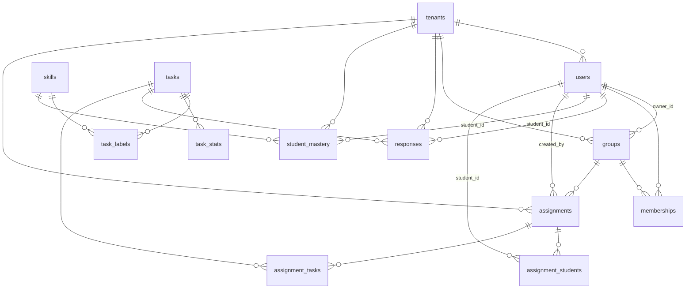
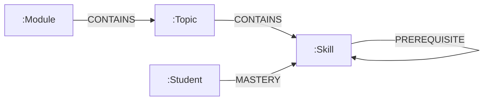

# HyperUm — Модель данных

**Версия:** 1.0
**Дата:** 2026-10
**Назначение:** полная схема данных системы. PostgreSQL + Neo4j + связи между ними.

**Связанные документы:**
- `glossary.md` — словарь
- `architecture.md` — архитектура
- `ml.md` — ML-модуль
- `api.md` — API

---

## 1. Обзор

HyperUm использует **две базы данных** с чётким разделением ролей:

| СУБД | Роль | Что хранит |
|------|------|-----------|
| **PostgreSQL 16** | Транзакции + RLS | Пользователи, группы, задания, разметки, ответы, mastery, назначения |
| **Neo4j 5** | Граф знаний | Модули, темы, навыки, prerequisit'ы, ребро `MASTERY` |

**Принцип:**
- Neo4j — источник **структуры** (что чему предшествует).
- PostgreSQL — источник **оценок** (кто что знает).

При чтении графа (`graph_service.get_student_graph`) структура берётся из Neo4j, mastery навешивается из PostgreSQL.

### 1.1. Три уровня данных

| Уровень | Таблицы/узлы | tenant_id |
|---------|-------------|-----------|
| **Global** | `tenants`, `skills`, `:Module`, `:Topic`, `:Skill` | `'global'` или `'demo'/'school_lyceum'` |
| **Shared** | `tasks`, `task_labels`, `task_stats` | — (без tenant) |
| **Isolated** | `users`, `groups`, `memberships`, `assignments*`, `responses`, `student_mastery`, `:Student`, `MASTERY` | обязателен + RLS |

---

## 2. PostgreSQL — полная схема

### 2.1. Tenancy

#### `tenants`

Справочник арендаторов. `kind` определяет контекст.

| Колонка | Тип | Ограничение | Описание |
|---------|-----|-------------|----------|
| `id` | TEXT | PK | `school_lyceum`, `demo`, `platform_polyum` |
| `name` | TEXT | NOT NULL | Отображаемое имя |
| `kind` | TEXT | NOT NULL, CHECK | `school` / `platform` / `demo` |

**Seed:**
```sql
INSERT INTO tenants (id, name, kind) VALUES
  ('school_lyceum', 'Лицей при ТПУ', 'school'),
  ('demo', 'Демонстрация', 'demo');
```

**Миграции:** `001_tenants.sql`, `016_demo_tenant.sql`.

### 2.2. Таксономия

#### `skills`

Денормализованная копия таксономии из Neo4j. Нужна для JOIN'ов и фильтров.

| Колонка | Тип | Ограничение | Описание |
|---------|-----|-------------|----------|
| `id` | TEXT | PK | `s_for`, `s_fano_direct` |
| `name` | TEXT | NOT NULL | «Цикл for» |
| `module` | TEXT | | «Программирование» |
| `topic` | TEXT | | «Циклы» |
| `difficulty` | REAL | DEFAULT 0.5 | Эталонная сложность навыка |
| `tenant_id` | TEXT | DEFAULT 'global' | 'global' = базовая таксономия |
| `created_at` | TIMESTAMPTZ | DEFAULT now() | |

**Загрузка:** `ml/sync_skills_to_pg.py` (из YAML + Neo4j).

**Миграция:** `002_shared.sql`.

### 2.3. Пользователи и группы

#### `users`

| Колонка | Тип | Ограничение | Описание |
|---------|-----|-------------|----------|
| `id` | UUID | PK, DEFAULT gen_random_uuid() | |
| `tenant_id` | TEXT | NOT NULL, FK → tenants | |
| `role` | TEXT | NOT NULL, CHECK | `owner` / `student` / `admin` |
| `full_name` | TEXT | | ФИО |
| `email` | TEXT | | Логин |
| `password_hash` | TEXT | | bcrypt (добавлено в 011) |
| `status` | TEXT | DEFAULT 'active', CHECK | `active` / `pending` / `blocked` (012) |
| `created_at` | TIMESTAMPTZ | DEFAULT now() | |

**Индексы:**
- `idx_users_tenant ON users(tenant_id)`
- `idx_users_email ON users(email)`

**Миграции:** `003_users_groups.sql`, `011_users_password.sql`, `012_classes_invites.sql`.

#### `groups`

| Колонка | Тип | Ограничение | Описание |
|---------|-----|-------------|----------|
| `id` | UUID | PK | |
| `tenant_id` | TEXT | NOT NULL, FK → tenants | |
| `owner_id` | UUID | FK → users | Учитель-владелец |
| `name` | TEXT | NOT NULL | «10А» |
| `kind` | TEXT | DEFAULT 'class', CHECK | `class` / `tutor_group` / `one_on_one` |
| `invite_code` | TEXT | UNIQUE WHERE NOT NULL | 6-символьный код (012) |
| `subject` | TEXT | DEFAULT 'informatics' | Предмет (012) |
| `created_at` | TIMESTAMPTZ | DEFAULT now() | |

**Индексы:**
- `idx_groups_tenant ON groups(tenant_id)`
- `idx_groups_invite_code ON groups(invite_code) WHERE NOT NULL` (012)
- `idx_groups_unique_name_class ON groups(tenant_id, name) WHERE kind='class'` (014)

**Миграции:** `003`, `012`, `014`, `016` (demo-группа).

#### `memberships`

Связь ученик ↔ группа. Композитный PK.

| Колонка | Тип | Ограничение | Описание |
|---------|-----|-------------|----------|
| `group_id` | UUID | PK, FK → groups ON DELETE CASCADE | |
| `user_id` | UUID | PK, FK → users ON DELETE CASCADE | |
| `role` | TEXT | NOT NULL, CHECK | `owner` / `student` |
| `status` | TEXT | DEFAULT 'active', CHECK | `active` / `pending` / `rejected` (012) |
| `joined_at` | TIMESTAMPTZ | DEFAULT now() | (013) |

**Миграции:** `003`, `012`, `013`.

### 2.4. Банк заданий

#### `tasks`

| Колонка | Тип | Ограничение | Описание |
|---------|-----|-------------|----------|
| `id` | UUID | PK | |
| `code` | TEXT | UNIQUE WHERE NOT NULL | `task_001` (007) |
| `text` | TEXT | NOT NULL | Текст задания |
| `answer` | TEXT | | Эталонный ответ |
| `type` | TEXT | | `single_choice` / `multi_choice` / `text` / `code` |
| `options` | JSONB | | Варианты (для choice) |
| `source` | TEXT | | Откуда пришло |
| `author_id` | UUID | | Автор |
| `author_tenant` | TEXT | | Tenant автора |
| `visibility` | TEXT | DEFAULT 'shared', CHECK | `shared` / `tenant` / `private` |
| `created_at` | TIMESTAMPTZ | DEFAULT now() | |

**Индексы:**
- `idx_tasks_code_unique ON tasks(code) WHERE code IS NOT NULL`

**Миграции:** `002_shared.sql`, `007_tasks_code.sql`.

#### `task_labels`

Разметка задания. **Multi-skill:** одно задание → 1 primary + 0–2 secondary.

| Колонка | Тип | Ограничение | Описание |
|---------|-----|-------------|----------|
| `task_id` | UUID | PK, FK → tasks ON DELETE CASCADE | |
| `skill_id` | TEXT | PK, FK → skills | |
| `model` | TEXT | PK | `deepseek` / `gigachat` / `manual` (010) |
| `difficulty` | REAL | | Оценка сложности |
| `confidence` | REAL | | Уверенность LLM |
| `is_primary` | BOOLEAN | DEFAULT FALSE | Флаг главного навыка (017) |
| `reasoning` | TEXT | | Обоснование от LLM (009) |
| `labeled_at` | TIMESTAMPTZ | DEFAULT now() | |

**PK:** `(task_id, skill_id, model)` — добавлен в 010.

**Индексы:**
- `idx_task_labels_model ON task_labels(model)`
- `idx_task_labels_primary ON task_labels(task_id, model) WHERE is_primary=TRUE` (017)

**Миграции:** `002`, `009`, `010`, `017`.

**Пример данных:**

| task_id | skill_id | model | difficulty | is_primary | reasoning |
|---------|----------|-------|-----------|------------|-----------|
| uuid_1 | s_nested | deepseek | 0.78 | TRUE | «Главное — вложенные циклы...» |
| uuid_1 | s_for | deepseek | 0.78 | FALSE | «Требуется понимание for...» |

#### `task_stats`

Агрегированная обезличенная статистика. Cross-tenant.

| Колонка | Тип | Ограничение | Описание |
|---------|-----|-------------|----------|
| `task_id` | UUID | PK, FK → tasks ON DELETE CASCADE | |
| `attempts_total` | INT | DEFAULT 0 | Всего попыток |
| `correct_total` | INT | DEFAULT 0 | Правильных |
| `avg_time_sec` | REAL | | Среднее время |
| `updated_at` | TIMESTAMPTZ | DEFAULT now() | |

**Статус:** таблица есть, но в коде пока не обновляется автоматически. **Точка роста.**

**Миграция:** `002_shared.sql`.

### 2.5. Учебный процесс

#### `assignments`

Сгенерированный тест. Один assignment содержит персональные наборы для всех учеников.

| Колонка | Тип | Ограничение | Описание |
|---------|-----|-------------|----------|
| `id` | UUID | PK | |
| `tenant_id` | TEXT | NOT NULL, FK → tenants | |
| `group_id` | UUID | FK → groups | |
| `created_by` | UUID | FK → users | Учитель (NULL для demo) |
| `topic` | TEXT | NOT NULL | Тема генерации |
| `title` | TEXT | NOT NULL | Название теста |
| `tasks_per_student` | INT | NOT NULL, DEFAULT 5 | Сколько заданий на ученика |
| `deadline` | TIMESTAMPTZ | | |
| `status` | TEXT | NOT NULL, DEFAULT 'draft', CHECK | `draft` / `sent` / `completed` |
| `created_at` | TIMESTAMPTZ | DEFAULT now() | |
| `sent_at` | TIMESTAMPTZ | | Момент отправки. **Ключевое поле:** все ответы после `sent_at` считаются принадлежащими этому assignment'у |

**Индексы:**
- `idx_assignments_tenant ON assignments(tenant_id)`
- `idx_assignments_group ON assignments(group_id)`

**Миграция:** `008_assignments.sql`.

#### `assignment_students`

Связка «ученик ↔ тест». Хранит статус прохождения.

| Колонка | Тип | Ограничение | Описание |
|---------|-----|-------------|----------|
| `assignment_id` | UUID | PK, FK → assignments ON DELETE CASCADE | |
| `student_id` | UUID | PK, FK → users ON DELETE CASCADE | |
| `status` | TEXT | NOT NULL, DEFAULT 'pending', CHECK | `pending` / `in_progress` / `completed` |
| `assigned_at` | TIMESTAMPTZ | DEFAULT now() | |
| `completed_at` | TIMESTAMPTZ | | Заполняется при автозакрытии |

**PK:** `(assignment_id, student_id)`.

**Миграция:** `008`.

#### `assignment_tasks`

Конкретное задание конкретному ученику с позицией.

| Колонка | Тип | Ограничение | Описание |
|---------|-----|-------------|----------|
| `assignment_id` | UUID | PK, FK → assignments ON DELETE CASCADE | |
| `student_id` | UUID | PK, FK → users ON DELETE CASCADE | |
| `task_id` | UUID | PK, FK → tasks | |
| `position` | INT | NOT NULL | Порядок в наборе |

**PK:** `(assignment_id, student_id, task_id)`.

**Индекс:** `idx_assignment_tasks_student ON assignment_tasks(student_id)`.

**Миграция:** `008`.

### 2.6. Ответы и оценки

#### `responses`

| Колонка | Тип | Ограничение | Описание |
|---------|-----|-------------|----------|
| `id` | UUID | PK, DEFAULT gen_random_uuid() | |
| `tenant_id` | TEXT | NOT NULL, FK → tenants | |
| `student_id` | UUID | NOT NULL, FK → users | |
| `task_id` | UUID | FK → tasks | |
| `answer` | TEXT | | Ответ ученика (пусто если skip) |
| `correct` | BOOLEAN | | NULL для пропусков |
| `time_sec` | INT | | Затраченное время |
| `skipped` | BOOLEAN | DEFAULT FALSE | Пропуск (015) |
| `surrendered` | BOOLEAN | DEFAULT FALSE | Финальная сдача (018) |
| `created_at` | TIMESTAMPTZ | DEFAULT now() | |

**Индексы:**
- `idx_responses_tenant_student ON responses(tenant_id, student_id)`
- `idx_responses_task ON responses(task_id)`

**RLS:** ENABLED + FORCED.

**Миграции:** `004`, `005`, `015`, `018`.

**Логика:**
- `skipped=TRUE, surrendered=FALSE` — пропуск (можно вернуться).
- `skipped=TRUE, surrendered=TRUE` — сдался (вернуться нельзя).
- `correct=NULL, skipped=FALSE` — аномалия (не должно быть).

#### `student_mastery`

| Колонка | Тип | Ограничение | Описание |
|---------|-----|-------------|----------|
| `tenant_id` | TEXT | PK, FK → tenants | |
| `student_id` | UUID | PK, FK → users | |
| `skill_id` | TEXT | PK, FK → skills | |
| `mastery` | REAL | NOT NULL | Сглаженный mastery [0, 1] |
| `attempts` | INT | DEFAULT 0 | **Сырое** число попыток |
| `correct` | INT | DEFAULT 0 | **Сырое** число правильных |
| `updated_at` | TIMESTAMPTZ | DEFAULT now() | |

**PK:** `(tenant_id, student_id, skill_id)`.

**RLS:** ENABLED + FORCED.

**Миграции:** `004`, `005`.

**Замечание:** `attempts` и `correct` — **сырые** (не взвешенные). Нужны для отображения в UI. Взвешенные считаются на лету в `responses_service.update_mastery`.

---

## 3. PostgreSQL — диаграмма связей



---

## 4. PostgreSQL — RLS (Row-Level Security)

Применяется к таблицам **isolated**-уровня.

### 4.1. Таблицы под RLS

| Таблица | RLS | FORCE |
|---------|-----|-------|
| `responses` | ✅ ENABLED | ✅ FORCED |
| `student_mastery` | ✅ ENABLED | ✅ FORCED |

**FORCE** означает, что политика действует даже на владельца таблицы (роль `hyperum`).

**Миграция:** `005_rls.sql`.

### 4.2. Политики

```sql
CREATE POLICY tenant_isolation_responses ON responses
  USING (tenant_id = current_setting('app.current_tenant', true));

CREATE POLICY tenant_isolation_mastery ON student_mastery
  USING (tenant_id = current_setting('app.current_tenant', true));
```

**Логика:**
- `current_setting('app.current_tenant', true)` — читает переменную сессии PostgreSQL.
- Второй аргумент `true` — не падать, если переменная не установлена (вернёт NULL).
- Если `app.current_tenant` не установлен → политика не пропускает **ничего** (безопасно).

### 4.3. Установка контекста

В `backend/db/postgres.py`:

```python
@contextmanager
def tenant_session(tenant_id: str):
    session = SessionLocal()
    try:
        session.begin()
        session.execute(
            text("SELECT set_config('app.current_tenant', :t, true)"),
            {"t": tenant_id},
        )
        yield session
        session.commit()
    except Exception:
        session.rollback()
        raise
    finally:
        session.close()
```

**`set_config(..., true)`** — третий аргумент `is_local=true` = `SET LOCAL`. Работает в пределах транзакции, сбрасывается при возврате соединения в пул.

**Критично:** без `is_local` значение могло бы «протечь» в следующий запрос на том же соединении.

### 4.4. Что вне RLS

Таблицы `tasks`, `task_labels`, `task_stats`, `skills` — **shared-уровень**. Видны всем tenant'ам без фильтрации. Разделение обеспечивается флагом `visibility` (`shared` / `tenant` / `private`) на уровне запросов в сервисах.

---

## 5. PostgreSQL — индексы (сводка)

| Таблица | Индекс | Назначение |
|---------|--------|-----------|
| `users` | `(tenant_id)` | Фильтр по tenant'у |
| `users` | `(email)` | Логин |
| `groups` | `(tenant_id)` | Список классов |
| `groups` | `(invite_code) UNIQUE WHERE NOT NULL` | Поиск по коду |
| `groups` | `(tenant_id, name) UNIQUE WHERE kind='class'` | Уникальность имени |
| `tasks` | `(code) UNIQUE WHERE NOT NULL` | Поиск по коду |
| `task_labels` | `(model)` | Фильтр по LLM |
| `task_labels` | `(task_id, model) WHERE is_primary=TRUE` | Primary-навык |
| `responses` | `(tenant_id, student_id)` | История ученика |
| `responses` | `(task_id)` | Статистика по заданию |
| `assignments` | `(tenant_id)` | Список назначений |
| `assignments` | `(group_id)` | Назначения класса |
| `assignment_tasks` | `(student_id)` | Задания ученика |

---

## 6. Neo4j — модель графа

### 6.1. Узлы

#### `:Module`

| Свойство | Тип | Описание |
|----------|-----|----------|
| `name` | string | «Программирование» |

#### `:Topic`

| Свойство | Тип | Описание |
|----------|-----|----------|
| `name` | string | «Циклы» |

#### `:Skill`

| Свойство | Тип | Описание |
|----------|-----|----------|
| `id` | string | `s_for` |
| `name` | string | «Цикл for» |
| `difficulty` | float | Эталонная сложность |

#### `:Student`

| Свойство | Тип | Описание |
|----------|-----|----------|
| `id` | string | UUID ученика |
| `tenant_id` | string | **Захардкожен** `school_lyceum` (техдолг) |

### 6.2. Связи

| Связь | Из | В | Свойства |
|-------|-----|---|----------|
| `CONTAINS` | `:Module` | `:Topic` | — |
| `CONTAINS` | `:Topic` | `:Skill` | — |
| `PREREQUISITE` | `:Skill` | `:Skill` | — |
| `MASTERY` | `:Student` | `:Skill` | `value`, `attempts`, `correct`, `updated_at` |

### 6.3. Диаграмма



### 6.4. Пример данных

```cypher
(:Module {name: 'Программирование'})
  -[:CONTAINS]->
(:Topic {name: 'Циклы'})
  -[:CONTAINS]->
(:Skill {id: 's_for', name: 'Цикл for', difficulty: 0.35})

(:Skill {id: 's_nested'})
  -[:PREREQUISITE]->
(:Skill {id: 's_for'})
```

**Смысл:** «Нельзя осваивать вложенные циклы, пока не освоен обычный for».

### 6.5. Запросы (используемые в коде)

**Полный граф:**
```cypher
MATCH (m:Module)-[:CONTAINS]->(t:Topic)-[:CONTAINS]->(s:Skill)
RETURN s.id, s.name, s.difficulty, m.name AS module, t.name AS topic
```

**Рёбра prerequisite:**
```cypher
MATCH (pre:Skill)-[:PREREQUISITE]->(target:Skill)
RETURN pre.id AS source, target.id AS target
```

**Проваленные prerequisite ученика:**
```cypher
MATCH (st:Student {id: $stid})-[m:MASTERY]->(pre:Skill)
WHERE m.value < 0.5
MATCH (pre)-[:PREREQUISITE]->(target:Skill)
WHERE target.id IN $sids
RETURN DISTINCT target.id AS blocked
```

**Синк mastery:**
```cypher
MERGE (st:Student {id: $sid})
SET st.tenant_id = 'school_lyceum'

MATCH (st:Student {id: $sid})
MATCH (sk:Skill {id: $skill})
MERGE (st)-[m:MASTERY]->(sk)
SET m.value = $val, m.attempts = $att, m.correct = $cor, m.updated_at = datetime()
```

---

## 7. Связь PostgreSQL ↔ Neo4j

```
┌──────────────────────────────────────────────────────────────┐
│                      ИСТОЧНИКИ ИСТИНЫ                        │
├──────────────────────────────────────────────────────────────┤
│                                                              │
│  Neo4j                                PostgreSQL             │
│  ─────                                ──────────             │
│  :Module                              skills                 │
│  :Topic                    ───►       (module, topic)        │
│  :Skill (id, name, diff)   ───►       skills (id, name, diff)│
│  PREREQUISITE              ───►       (только в Neo4j)       │
│                                                              │
│  :Student (id)                        users (id, tenant_id)  │
│  MASTERY                   ◄───       student_mastery        │
│  (копия для визуализации)              (источник истины)     │
│                                                              │
└──────────────────────────────────────────────────────────────┘
```

**Правила:**

1. **Таксономия** — источник в YAML (`taxonomy/informatics_10_11.yaml`). Синхронизируется **и** в Neo4j, **и** в PostgreSQL.
2. **Prerequisite** — только в Neo4j. В PostgreSQL нет таблицы для них.
3. **Mastery** — источник истины в PostgreSQL. В Neo4j — **копия** для быстрой визуализации графа.
4. **Sync mastery** — best-effort, обёрнут в `try/except`.

---

## 8. Миграции

18 файлов в `migrations/`. Применяются идемпотентно скриптом `scripts/migrate.ps1`.

| # | Файл | Что делает |
|---|------|-----------|
| 001 | `tenants.sql` | Таблица `tenants` + seed `school_lyceum` |
| 002 | `shared.sql` | `skills`, `tasks`, `task_labels`, `task_stats` |
| 003 | `users_groups.sql` | `users`, `groups`, `memberships` |
| 004 | `responses_mastery.sql` | `responses`, `student_mastery` + индексы |
| 005 | `rls.sql` | RLS-политики на `responses`, `student_mastery` |
| 006 | `seed.sql` | Seed-данные: пользователи, класс 10А, базовые навыки |
| 007 | `tasks_code.sql` | Колонка `tasks.code` + UNIQUE |
| 008 | `assignments.sql` | `assignments`, `assignment_students`, `assignment_tasks` |
| 009 | `task_labels_reasoning.sql` | Колонка `task_labels.reasoning` |
| 010 | `task_labels_pk.sql` | Расширение PK до `(task_id, skill_id, model)` |
| 011 | `users_password.sql` | Колонка `users.password_hash` + индекс по email |
| 012 | `classes_invites.sql` | `invite_code`, `subject`, `status` для `users`/`memberships` |
| 013 | `memberships_joined_at.sql` | Колонка `memberships.joined_at` |
| 014 | `groups_unique_name.sql` | Уникальность имени класса в tenant'е |
| 015 | `responses_skipped.sql` | Колонка `responses.skipped` |
| 016 | `demo_tenant.sql` | Расширение CHECK + tenant `demo` + demo-группа |
| 017 | `multi_skill_labels.sql` | Колонка `task_labels.is_primary` + индекс |
| 018 | `skipped_locked.sql` | Колонка `responses.surrendered` |

---

## 9. Заметки и техдолг

### 9.1. Известные проблемы

| Проблема | Где | Приоритет |
|----------|-----|-----------|
| Хардкод `tenant_id='school_lyceum'` в `save_assignment` | `assignments_service.py` | MUST |
| Хардкод `tenant_id='school_lyceum'` в `sync_mastery_to_neo4j` | `responses_service.py` | MUST |
| Neo4j `_fetch_full_graph` не фильтрует по tenant | `graph_service.py` | SHOULD |
| `task_stats` не обновляется автоматически | — | SHOULD |
| `visibility` на `tasks` не проверяется в запросах | `tasks_service.py` | SHOULD |
| Нет партиционирования `responses` по tenant'у | — | COULD |

### 9.2. Отсутствующие, но ожидаемые таблицы

- **`audit_log`** — логирование действий (требование NFR-3.4). Не реализовано.
- **`password_reset_tokens`** — восстановление пароля (FR-8.5). Не реализовано.
- **`refresh_tokens`** — для отзыва refresh-токенов. Сейчас refresh stateless.

### 9.3. Соглашения

- **UUID v4** — через `gen_random_uuid()` (pgcrypto).
- **TIMESTAMPTZ** — везде, а не `TIMESTAMP`. Часовые пояса не теряем.
- **ON DELETE CASCADE** — для дочерних таблиц (`memberships`, `assignment_*`, `task_labels`, `task_stats`).
- **CHECK-констрейнты** — везде, где есть enum-значения. Явные, а не через отдельные справочники.

---

## 10. Изменения

| Версия | Дата | Что изменилось |
|--------|------|----------------|
| 1.0 | 2026-10 | Первая полная версия |